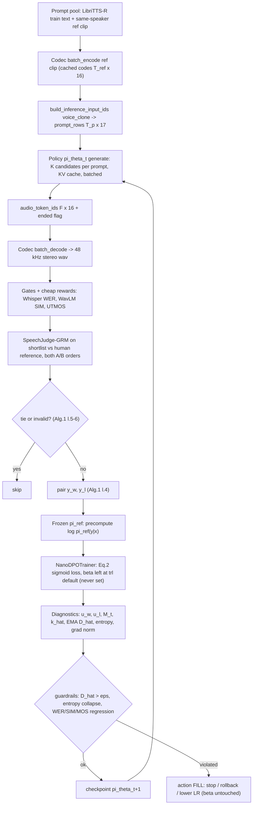

# Online DPO for MOSS-TTS-Nano — Design Document

Status: design + skeleton (nothing here is meant to run as-is). Date: 2026-10-23.

Sources this design is built on (all read directly, not paraphrased from memory):

| Source | Pinned version |
|---|---|
| KL paper: *On the Optimality of Global Improvement Regularization over Local KL Maximization in Incremental Direct Preference Optimization* (A. S. Yadav, Oct 2026), `docs/KL_divergence_paper.pdf`, all 6 pages | — |
| Model: [`OpenMOSS-Team/MOSS-TTS-Nano-100M`](https://huggingface.co/OpenMOSS-Team/MOSS-TTS-Nano-100M) (`OpenMOSS-Team/MOSS-TTS-Nano` 307-redirects here) | commit `44502f80dbf9743528fa921cc544d662c685ebec` |
| Codec: [`OpenMOSS-Team/MOSS-Audio-Tokenizer-Nano`](https://huggingface.co/OpenMOSS-Team/MOSS-Audio-Tokenizer-Nano) | commit `6aa02b01e445cc585582cf0ba480bc3ea6c8dd68` |
| Code + official SFT recipe: [github.com/OpenMOSS/MOSS-TTS-Nano](https://github.com/OpenMOSS/MOSS-TTS-Nano) (`finetuning/sft.py`, `finetuning/dataset.py`, `ort_cpu_runtime.py`, `infer.py`) | commit `8b7bcc9341b3b4ef3a3a58ba1338a7d85ff133eb` |
| `trl` (`trainer/dpo_trainer.py`, `trainer/dpo_config.py`, `experimental/online_dpo/*`, `trainer/utils.py`) | tag `v1.16.0` (latest on PyPI at time of writing) |
| Existing VoiceGym code: `voicegym/benchmark/{judge,metrics,generate_tts}.py`, `VoiceGym_SpeechJudge_Project_Plan.md` | workspace |

Notation: `[FILL: per user's paper]` = a value the user's own (unavailable) paper must specify. `[UNVERIFIED: …]` = could not be confirmed from the sources above. `[ESTIMATE]` = derived arithmetic, not measured.

---

## a. KL-paper concepts and the design decisions they drive

### a.1 What the paper says (with locations)

1. **Objective (§1, Eq. 1).** Reverse-KL-regularised reward maximisation: `max_π E[r(x,y)] − β·D_KL(π_θ(·|x) ‖ π_ref(·|x))`. Only **reverse** KL is used. Forward KL is not discussed anywhere in the paper.
2. **DPO loss (§1, Eq. 2).** The usual reparameterisation: `L_DPO = −E log σ(β log π_θ(y_w|x)/π_ref(y_w|x) − β log π_θ(y_l|x)/π_ref(y_l|x))`.
3. **Online vs offline (§1, §5).** DPO is sensitive to β and to *off-policy distributional drift* (refs [2],[4]). Without a preference dataset, alignment must be *incremental* via Online AI Feedback (ref [3]): at each step the **current** policy samples candidates, an automated evaluator labels them, and the policy is updated immediately. In this regime, poor KL control "either amplifies single-sample annotation noise into catastrophic policy collapse or stalls learning".
4. **H1, "local-maximum KL", is rejected (§2 Eq. 3; §3.1 Thm 3.1, Eqs. 4–6).** `K(π)=D_KL(π‖π_ref)` has its Hessian `diag(1/π) ≻ 0` on the simplex interior (Eq. 5–6). Its only interior stationary point, `π = π_ref`, is a global *minimum*. By Bauer's maximum principle, its maxima are at Dirac vertices, which corresponds to β→0⁺. Pushing there drives `π_θ(y_l|x)→0`, makes the implicit-reward margin diverge, and causes **entropy/mode collapse**.
5. **H2, "global net-improvement", is accepted (§3.2 Thm 3.2, Eqs. 7–17).** Under a second-order cumulant expansion of `log Z` (Eqs. 10–11):
   - expected improvement `Δ(β) = σ̄_r²/β` (Eq. 13)
   - expected KL `E[D_KL(π*_β‖π_ref)] = σ̄_r²/(2β²)` (Eq. 14)
   - `U(β) = σ̄_r²/β − λσ̄_r⁴/(8β⁴)` (Eq. 15), uniquely maximised at `β* = (λσ̄_r²/2)^{1/3}` (Eq. 9/16), or equivalently `β* = sqrt(σ̄_r²/(2ε))` for a KL trust region `ε` (Eq. 9).
   - Here `σ̄_r²` is the reward variance under `π_ref`, averaged over prompts.
6. **Gradient/regret bounds (§4, Eq. 18, Table 1).** `‖g_t‖ ≤ 2β_t G`. Keeping β in `[β_min, β_max]` gives `O(√T)` regret, whereas H1 gives `O(T)` regret and overfits single noisy comparisons. Table 1 also states that the log-ratio variance is bounded by `2ε = σ̄_r²/β*²`.
7. **Algorithm 1 (§5)** for incremental, dataset-free DPO:
   - sample **K ≥ 2 on-policy** responses (line 3)
   - have the judge rank them and form `(y_w, y_l)` (line 4)
   - **skip ties or invalid candidates** (lines 5–6)
   - compute log-ratios `u_w, u_l` (line 8), the margin `M_t = u_w − u_l`, and the KL proxy `k̂_t = ½(u_w² + u_l²)` (line 9)
   - update an EMA `D̂_t` (line 10)
   - take a DPO primal step (line 11)
   - take a **dual ascent step on β** toward β* (line 12)
   - `π_ref` stays fixed throughout, with `π_θ1 ← π_ref` (Require line).

### a.2 Conflict you need to know about

The paper's central prescription (H2, Eq. 9/16, and Algorithm 1 line 12) is to **choose or adapt β**. Your hard constraint is that β is never set or modified. **This pipeline obeys the constraint.** β is never passed, so it stays at the `trl` library default. Algorithm 1 line 12 is therefore **disabled**. Everything else from the paper is kept, and the paper's KL quantities are *monitored* instead of being fed back into β. KL control then has to come from other levers (fixed reference, step size, early stopping or rollback), and those are `[FILL: per user's paper]`. If your paper resolves this differently, for example by fixing β but bounding ε through the step count, plug that in where marked.

### a.3 Concept → pipeline decision

| Paper element | Pipeline decision |
|---|---|
| Eq. 1, fixed `π_ref`; Alg. 1 "Require π_ref", `π_θ1 ← π_ref` | `π_ref` = frozen MOSS-TTS-Nano-100M @ `44502f8…`, never refreshed. Do **not** use `sync_ref_model` / TR-DPO, and do **not** let `trl` copy the current LoRA adapter into a "ref" adapter (see §d.6). |
| Eq. 1 reverse KL | Keep `trl`'s default `f_divergence_type="reverse_kl"`. The subclass asserts it. |
| Eq. 2 | `loss_type=["sigmoid"]` only. The subclass implements exactly Eq. 2. |
| §1/§5 online, OAIF, drift sensitivity | Regenerate pairs from the **current** checkpoint every round. Each pair is used for one pass only (no replay of stale pairs). |
| Alg. 1 line 3, `y ~ π_θt`, K ≥ 2 | K on-policy candidates per prompt from the current policy. Log-probs are scored at temperature 1 over the same support the sampler uses (see §c, "on-policy note"). |
| Alg. 1 lines 4–6 | A reward cascade ranks the candidates. Ties (`r_w − r_l < δ`) and invalid candidates (no `audio_end`, decode failure, gate failure) are skipped. |
| Alg. 1 lines 8–10 | The trainer logs `u_w`, `u_l`, `M_t`, `k̂_t` and the EMA `D̂_t` on every step. |
| Alg. 1 line 12 | **Disabled** (β constraint). `D̂_t > ε` triggers a guardrail action `[FILL: per user's paper]` instead. |
| Thm 3.1, H1 rejected | Never optimise toward larger KL. Monitor for boundary collapse: per-codebook entropy, `log π_θ(y_l)` → −∞, unbounded margins. |
| Eq. 14, Table 1 | Diagnostics: the reward variance `σ̂_r²` under `π_ref` (round 0) predicts `E[KL] ≈ σ̄_r²/(2β²)` at the library-default β. Observed log-ratio variance is checked against `2ε`. This is only meaningful if the reward is on a Bradley–Terry logit scale: `[FILL: per user's paper — reward calibration]`. |
| §4, `‖g_t‖ ≤ 2β_t G` | Gradient-norm clipping (`max_grad_norm` `[FILL]`) and grad-norm logging. |
| Alg. 1 is per-pair (t = one pair) | The pipeline batches R pairs per round for GPU efficiency. **This is a deviation**: `R = 1`, 1 step per round recovers Alg. 1 exactly. `R` is `[FILL: per user's paper]`. |

---

## b. Architecture overview (workload view)

MOSS-TTS-Nano-100M is a 117.3M-parameter, purely autoregressive **global/local transformer** over MOSS-Audio-Tokenizer-Nano codes (48 kHz stereo, 12.5 frames/s, 16 RVQ codebooks × 1024 entries).

Each frame is one row of 17 ids: 1 text/control id plus 16 audio ids. The row's embeddings are summed, so the 12-layer GPT-2-style global decoder (d = 768, 12 heads, RoPE, 16,384-token text vocabulary) runs **once per frame**, i.e. 12.5 steps per audio second, with a normal KV cache. A 1-layer local transformer (7.1M params) then emits, inside each frame, a 2-way continue/stop decision followed by the 16 codebook tokens, one after another (17 positions).

**Where the FLOPs go.** The released PyTorch generation loop runs the local transformer with `use_cache=False`. It therefore re-encodes prefixes of length 1…17, which is 153 position-passes per frame. That costs ≈2.17 GFLOP, against ≈0.17 GFLOP for the global step `[ESTIMATE]`, so about 90% of LM FLOPs sit in a 7M-parameter layer. A local KV cache, which the official ONNX runtime already implements as `local_cached_step`, cuts per-frame cost about 5×.

**GPU vs CPU.** At batch 1 on a GPU, each frame is launch- and sync-bound: about 29 sequential layer calls and 18 host syncs per frame. CUDA graphs and removing syncs therefore matter more than FLOPs there. On CPU, FLOPs dominate.

**Codec.** The ~20M-parameter causal-transformer codec costs an estimated 4–7 GFLOP per audio second, comparable to the LM once the local cache exists.

**Training.** Sequences are short (≈100–400 rows), so the wall-clock of online DPO is dominated by **rollouts and the reward judge**, not by the policy update.

### b.1 Verified architecture facts

All from `config.json`, `modeling_moss_tts_nano.py`, `gpt2_decoder.py` and the codec `config.json` at the pinned commits. Parameter counts come from instantiating the model on the `meta` device with the official code (no weights downloaded).

| Item | Value |
|---|---|
| Class / loading | `MossTTSNanoForCausalLM` (`model_type: moss_tts_nano`, `architectures` + `auto_map`). Loads with `AutoModelForCausalLM.from_pretrained(..., trust_remote_code=True)`. Custom code; **not** a stock transformers architecture. |
| Inherits `GenerationMixin`? | **No.** `can_generate()` is False and `model.generation_config is None`. The model has its own `generate()` returning `MossTTSNanoGenerationOutput(audio_token_ids[B,F,16])`. |
| Training forward | `forward(labels=...)` **raises** `NotImplementedError` ("inference-only"). `forward()` returns only `global_hidden_states`, no logits. Training must recompute logits the way `finetuning/sft.py::compute_supervised_loss` does. |
| Global backbone | `MossTTSNanoGPT2Model`: 12 layers, `n_embd` 768, 12 heads, `n_inner` 3072, `gelu_new`, RoPE (base 1e4), `n_positions` 32,768. Linear layers are named `c_attn`, `c_proj`, `fc_in`, `fc_out`. |
| Local transformer | Same block type, `local_transformer_layers: 1`, `n_positions = n_vq + 1 = 17`, `wte = Identity`. |
| Input row | `[B, T, 17]`. Column 0 = text id (vocab 16,384, SentencePiece, `MossTTSNanoSentencePieceTokenizer`). Columns 1..16 = audio ids (1024 each; `audio_pad_token_id` = 1024). Embedding = `wte(text) + Σ_c audio_emb_c(a_c)`, with pad entries masked. |
| Special ids | `pad` 3, `im_start` 4, `im_end` 5, `audio_start` 6, `audio_end` 7, `audio_user_slot` 8, `audio_assistant_slot` 9 |
| Per-frame prediction | Local positions are `[h_global, wte(text_tok), emb_0(a_0) … emb_14(a_14)]`. Position 0 gives the text logits, sampled **only over {slot=9, end=7}**. Position c+1 gives the logits for codebook c. |
| Heads | `text_lm_head` tied to `transformer.wte`; `audio_lm_heads[c]` tied to `audio_embeddings[c]` |
| Params (unique) | **117,311,232** total: `transformer` 97.64M (incl. 12.58M text embedding), `audio_embeddings` 12.58M (tied with heads), `local_transformer` 7.09M. Checkpoint `pytorch_model.bin` is 234.7 MB, which is consistent with 16-bit storage `[UNVERIFIED: stored dtype; config says float32]`. |
| Attention | eager / sdpa / `flash_attention_2` (default in config; needs CUDA + fp16/bf16). Supports packed sequences via `cu_seqlens` (flash-attn varlen, `use_cache=False`). |
| Gradient checkpointing | `supports_gradient_checkpointing = False` at the `PreTrainedModel` level, **but** the inner `MossTTSNanoGPT2Model` honours `self.gradient_checkpointing = True` (non-reentrant) during training |
| Prompting (voice clone) | `build_inference_input_ids(mode="voice_clone")`: user template, then reference-audio rows (slot 8), then text, then assistant prefix, then `audio_start`. Generated rows use slot 9, and generation ends with a row whose text id is `audio_end`. Long text is chunked at `voice_clone_max_text_tokens = 50`. |
| Decoding defaults | `generate()`: `do_sample=False`, text T=1.5, audio T=1.7 / top-p 0.8 / top-k 25. `infer.py` CLI: `do_sample=1`, text T=1.0, top-p 1.0, top-k 50, audio T=0.8, top-p 0.95, top-k 25, `repetition_penalty` 1.2. The CLI help strings say 1.5/1.7, but the code values are the ones above. |
| Codec | MOSS-Audio-Tokenizer-Nano (`MossAudioTokenizerModel`, `trust_remote_code`). 48 kHz, 2 channels (interleaved), `downsample_rate` 3840 → **12.5 Hz**. Quantiser `rlfq`, 16 quantisers × 1024, `codebook_dim` 8, `rvq_dim` 512. Causal transformer encoder/decoder (d_model 256, 4 heads, FFN 1024, context windows 4–10 s), no CNNs. About 20M params (model card). Bitrate 0.125–4 kbps via `nq`. API: `batch_encode([wav(C,T)], chunk_duration=None)`, `batch_decode([codes], num_quantizers=nq, chunk_duration=None)`. |
| Licence | Apache-2.0 (HF model and codec cards; GitHub `LICENSE`). The HF README body still says "follow root LICENSE". |
| Deps (official) | `transformers==4.57.1`, `torch==2.7.0`, `sentencepiece`, `WeTextProcessing` (text normalisation), `onnxruntime` |
| Official training | `finetuning/sft.py`: SFT only, CUDA required, accelerate, bf16, per-head loss weights (`"1,32"` = text 1, audio total 32). **No official DPO/RL code** in the repo. |
| vLLM | No vLLM support found for this custom global/local architecture `[UNVERIFIED: absence]` |

### b.2 FLOP breakdown `[ESTIMATE]`

Matmul FLOPs ≈ 2 × params touched. Attention-score FLOPs are ignored for the LM (local context ≤ 17; global context is short).

| Per generated frame (batch 1) | As released | With local KV cache (+ 2-logit text head) |
|---|---|---|
| Global step: 12 layers, 85.06M non-embedding params | 0.170 GFLOP | 0.170 |
| Local transformer: 7.09M params × position-passes | 153 passes → **2.169 GFLOP** | 17 passes → 0.241 |
| Text head (full 16,384-way, then `index_select` of 2) | 0.025 | ≈0 (2 rows of the weight) |
| 16 audio heads | 0.025 | 0.025 |
| **Total / frame** | **≈2.39 GFLOP** | **≈0.44 GFLOP (≈5.4× less)** |
| Per audio second (× 12.5) | ≈29.9 GFLOP | ≈5.5 GFLOP |
| Sequential kernel "depth" per frame | 1 global call (12 layers) + 17 local calls; 18 `.item()`-style host syncs (17 `_ensure_finite_generation_logits` + 1 `should_continue.any()`), plus B×16 more if `repetition_penalty ≠ 1` (Python loop in `_apply_repetition_penalty`) | same depth; syncs removable |

**Codec decode** `[ESTIMATE, derived from config]`. Stages run 12.5 Hz → ×4 → 50 Hz (4 layers, 10 s window) → ×2 → 100 Hz (2 layers, 8 s) → ×2 → 200 Hz (2 layers, 6 s) → ×2 → 400 Hz (4 layers, 4 s) → ×240 → 96k samples/s (= 48 kHz × 2 channels). That is 2,400 position-layers per audio second at ≈1.57 MFLOP each, ≈3.8 GFLOP, plus up to ≈3.4 GFLOP of windowed attention at full context. Total ≈4–7 GFLOP per audio second. Encoding is only needed for reference clips and can be cached.

**Training, per DPO sequence** `[ESTIMATE]`.
- Global forward costs 0.17 GFLOP per row for every row.
- The local transformer plus heads cost ≈0.27 GFLOP per row, but are only needed on **completion rows**. The official SFT loss runs the local transformer on every row.
- At prompt length ≈ completion length, restricting the local pass to completion rows saves ≈30% of forward FLOPs.
- Backward ≈ 2× forward. The reference forward costs 1× (or 0 during training with precomputed reference log-probs).
- For a 300-row pair this is roughly 0.5 TFLOP per pair: negligible next to rollouts and the judge.

---

## c. Online DPO pipeline (step by step)

### c.1 Bullet pipeline

- **0. Setup (once).**
  - Load policy `π_θ` and frozen `π_ref` from `OpenMOSS-Team/MOSS-TTS-Nano-100M@44502f8…` with `trust_remote_code=True`.
  - Load the codec `MOSS-Audio-Tokenizer-Nano@6aa02b0…` and the SentencePiece tokenizer.
  - Set `policy.generation_config = GenerationConfig()`, because `trl` writes `pad_token_id` into it and the model has none.
  - Optional LoRA (§e).
  - Start the reward services: SpeechJudge-GRM in `.venv-judge`; Whisper, WavLM and UTMOS as in `benchmark/metrics.py`.
- **1. Prompt sampling** (Alg. 1 line 3, `x_t ~ P`).
  - Draw `n_prompts` `[FILL]` items `x = (text, reference clip)`. Default source: LibriTTS-R **train** splits `[FILL: per user's paper]`. Never use `test-clean`, which is the VoiceGym held-out benchmark.
  - Reference clip = same speaker, different utterance, 4–10 s, mirroring `prepare_data.py`.
  - Keep text ≤ 50 SentencePiece tokens so that one `generate` call equals one completion; Nano chunks longer voice-clone text.
  - Encode each reference clip **once** with `codec.batch_encode` and cache the `(T_ref, 16)` codes.
- **2. On-policy generation of K candidates** (Alg. 1 line 3, K ≥ 2; K `[FILL: per user's paper]`).
  - Build `prompt_rows` with `policy.build_inference_input_ids(text, tok, mode="voice_clone", prompt_audio_codes=...)`.
  - Replicate each prompt K times, left-pad (as `_left_pad_inference_batch` does), and call `policy.generate(do_sample=True, use_kv_cache=True, max_new_frames=[FILL])` in large batches.
  - Record `audio_token_ids (F,16)` and `ended = (n_valid_frames < max_new_frames)`.
  - **On-policy note.** Alg. 1 assumes `y ~ π_θt`. Nano's sampler uses temperature, top-k/top-p and a repetition penalty, so samples come from a *modified* distribution, while DPO scores `log π_θ` at temperature 1. For strict on-policy sampling use `audio_temperature=1, audio_top_k=0, audio_top_p=1, text_temperature=1, text_top_k=0, text_top_p=1, audio_repetition_penalty=1`. Whether to use those or the deployment decoding settings is `[FILL: per user's paper]`.
  - The text channel is sampled over {slot, end} only. The log-prob in §d uses the same 2-way support.
- **3. Codec decode.**
  - `codec.batch_decode([codes...], num_quantizers=nq)` gives 48 kHz stereo waveforms.
  - Use the same `nq` for generation, decoding and log-prob computation (default 16 `[FILL]`).
  - Downmix or resample to 16 kHz mono for ASR, SIM and UTMOS, as `metrics.py` does.
- **4. Preference labelling** (Alg. 1 line 4). Reward choice is `[FILL: per user's paper]`. The suggested cascade reuses existing VoiceGym components:
  - **Hard gates → invalid** (Alg. 1 line 5):
    - no `audio_end` (`ended == False`)
    - decode error
    - duration ratio outside `[FILL]`
    - WER > `[FILL]` (Whisper `openai/whisper-large-v3`)
    - SIM < `[FILL]` (`microsoft/wavlm-base-plus-sv`)
  - **Cheap scalar reward on all K:** `r = w_wer·(−WER) + w_sim·SIM + w_mos·UTMOS22` (or DNSMOS) with weights `[FILL: per user's paper]`.
  - **Expensive judge on a shortlist:** SpeechJudge-GRM (`RMSnow/SpeechJudge-GRM`, CC BY-NC 4.0) scores each shortlisted candidate against the **human reference recording** in both A/B orders. This is exactly VoiceGym's `judge.py` closeness (`TTS/human × 100`), and it costs 2 calls per candidate instead of K(K−1) pairwise calls. Shortlist size is `[FILL]`.
- **5. Pair construction** (Alg. 1 lines 4–6).
  - Per prompt, take the valid candidates. If fewer than 2, skip.
  - `y_w = argmax r`, `y_l = argmin r` (or another policy `[FILL: per user's paper]`).
  - If `r_w − r_l < δ` `[FILL]`, treat it as a tie and skip.
  - Store `{prompt_rows, chosen_codes, chosen_ended, rejected_codes, rejected_ended, rewards, round}`.
  - Also log the within-prompt reward variance. In round 0 (`π_θ = π_ref`) its mean estimates `σ̄_r²` (Thm 3.2).
- **6. Reference log-probs.**
  - Frozen `π_ref` computes `log π_ref(y|x)` for chosen and rejected once per round (`precompute_ref_log_probs=True`).
  - The same `nano_sequence_logps` function is used for policy and reference (§d.3).
- **7. DPO loss and policy update** (Alg. 1 lines 8–11).
  - `NanoDPOTrainer` (a `trl.DPOTrainer` subclass) computes `u_w, u_l`, `M_t`, and Eq. 2 with `self.beta` **read-only**, at the library default.
  - One epoch over the round's fresh pairs (`[FILL]`), AdamW, `max_grad_norm` `[FILL]`, bf16.
- **8. Diagnostics and guardrails** (Alg. 1 lines 9–10; Thm 3.1; Table 1).
  - Log `k̂_t`, the EMA `D̂_t` (α `[FILL]`), the log-ratio variance, per-codebook entropy, `log π_θ(y_l)`, the margin and the grad norm.
  - If `D̂_t > ε` (`[FILL: per user's paper]`), or entropy collapses (`[FILL]` threshold), take action `[FILL: per user's paper]`: stop the round early, roll back to the previous checkpoint, or reduce the learning rate. **β is never touched.**
- **9. Refresh rules.**
  - After every round the rollout policy becomes the just-updated `π_θ`, so the next round is on-policy again.
  - `π_ref` is **never** refreshed (Eq. 1, Alg. 1).
  - Optimizer state: reset or carry over per round `[FILL]`.
  - Checkpoint every `[FILL]` rounds with the remote-code files copied, as `sft.py::save_checkpoint` does.
  - Every `[FILL]` rounds run the held-out evaluation (§f). Stop if WER, SIM or MOS guardrails regress beyond `[FILL]`.
  - Total rounds T `[FILL]`.

### c.2 Data flow



### c.3 Integration with this repo (VoiceGym)

Three environments are needed, because `transformers` pins conflict:
- **`.venv-judge`** (existing): SpeechJudge-GRM with `transformers==4.52.3`. Run it as a long-lived scoring service (HTTP or a file queue) built from the existing `load_judge()` in `benchmark/judge.py`.
- **`.venv-nano-train`** (new): `torch`, `transformers==4.57.1` (the Nano pin; `trl` 1.16.0 requires ≥4.56.2), `trl==1.16.0`, `peft`, `accelerate>=1.10.1`, `datasets>=4.7.0`, `sentencepiece`. It runs rollout, decode and training. The existing `.venv-tts` has `transformers==4.57.3` and **no `sentencepiece`**; whether Nano works on 4.57.3 is `[UNVERIFIED]`.
- **Metrics** (Whisper, WavLM, UTMOS): refactor `benchmark/metrics.py` into importable `score_wer / score_sim / score_utmos` functions so both the benchmark and the reward cascade use **identical** models and text normalisation.

Proposed new files (design only, not created):

```
voicegym/dpo/
  rollout.py       # prompt sampling, cached ref-clip codes, batched generate, codec decode
  rewards.py       # gates + cheap metrics + SpeechJudge client; tie/invalid logic
  pairs.py         # pair construction, per-round HF Dataset, sigma_r^2 estimate
  collator.py      # NanoPreferenceCollator          (section d.2)
  logps.py         # nano_sequence_logps             (section d.3)
  trainer.py       # NanoDPOTrainer + KL tracker     (section d.4)
  loop.py          # round orchestration             (section d.5)
voicegym/benchmark/generate_tts_nano.py   # Nano backend with the same CLI as generate_tts.py
```

`scripts/run_benchmark.sh` then gets `TTS_BACKEND=qwen3|nano` so the locked 500-sentence manifest can benchmark base Nano, DPO'd Nano, and optimised DPO'd Nano unchanged.

---

## d. Skeleton code (trl-based)

> **Correction to the original example.** `DPOTrainer`, `DPOConfig` and `OnlineDPOTrainer` are **not** in `transformers`. Import `DPOConfig` and `DPOTrainer` from **`trl`**. In `trl` 1.16.0 (verified at tag `v1.16.0`), `OnlineDPOTrainer` and `OnlineDPOConfig` live only in **`trl.experimental.online_dpo`**, and the old `trl.judges` module no longer exists; online DPO takes `reward_funcs` instead.
>
> The tokenizer argument is **`processing_class=`** (renamed from `tokenizer=` in trl 0.12). `DPOTrainer.__init__` in 1.16.0 has no `tokenizer` parameter at all.
>
> **β is never set** in any code below. It keeps the `DPOConfig` library default (documented as 0.1 in trl 1.16.0), and the code only reads `self.beta`.

### d.1 Where trl 1.16.0's text assumptions break for Nano (verified in source)

| trl assumption (file / location) | Why it breaks for Nano | Fix in this skeleton |
|---|---|---|
| `_prepare_dataset` tokenizes `prompt` / `chosen` / `rejected` strings and appends EOS | The data are `[T,17]` id grids; there is no text completion | Override as a pass-through |
| Default `DataCollatorForPreference` pads 1-D `input_ids` | Rows are 3-D `[2B, L, 17]` with two pad ids (text 3, audio 1024) | Custom `NanoPreferenceCollator` |
| `_compute_loss`: `labels = input_ids.masked_fill(completion_mask == 0, -100)`; `model(..., labels=labels, fused_lm_head=True).log_probs` | 2-D mask against 3-D ids fails. Nano's `forward(labels=…)` raises. There are no logits and no `lm_head`; there are 17 heads per row plus the local transformer. | Override `_compute_loss` and `compute_ref_log_probs`, calling `nano_sequence_logps` |
| `__init__`: `model.generation_config.pad_token_id = …` | `generation_config is None` (no `GenerationMixin`) | Set `model.generation_config = GenerationConfig()` before constructing the trainer |
| `DPOConfig.gradient_checkpointing` defaults to **True**, so `Trainer` calls `model.gradient_checkpointing_enable()` | `supports_gradient_checkpointing = False` makes that raise `ValueError` | `gradient_checkpointing=False`; set `base.transformer.gradient_checkpointing = True` manually |
| `__init__`: `add_fused_lm_head(model)` patches `forward` | Harmless: it passes through when `fused_lm_head` is not set. The subclass never sets it. | none |
| PEFT model passed with `ref_model=None` → `trl` adds a `"ref"` adapter **copied from the current adapter** | From round 2 on, the reference would become the *current* policy, violating the fixed `π_ref` of Eq. 1 / Alg. 1 | Override `compute_ref_log_probs` to always use `disable_adapter()` (base = `π_ref`), or prefer full fine-tuning with an explicit frozen `ref_model` |
| `prediction_step(prediction_loss_only=False)` reads `outputs.logits` | No logits | `prediction_loss_only=True` |
| `OnlineDPOTrainer`: `_generate` (2-D text `generate`), `_forward` (`output.logits`), `training_step` (exactly 2 samples, `batch_decode` to text, ties → first sample wins) | All text-specific; tie handling contradicts Alg. 1 lines 5–6 | Not recommended; see d.7 |

### d.2 Collator

```python
# voicegym/dpo/collator.py
import torch


class NanoPreferenceCollator:
    """Batches (prompt_rows, chosen_codes, rejected_codes) into Nano's [2B, L, n_vq+1] id grid.

    Output order matches trl's convention: first B sequences = chosen, last B = rejected.
    """

    def __init__(self, config):
        self.n_vq = int(config.n_vq)                              # 16
        self.text_pad = int(config.pad_token_id)                  # 3
        self.audio_pad = int(config.audio_pad_token_id)           # 1024
        self.slot = int(config.audio_assistant_slot_token_id)     # 9
        self.audio_end = int(config.audio_end_token_id)           # 7

    def _completion_rows(self, codes: torch.LongTensor, ended: bool) -> torch.LongTensor:
        rows = torch.full((codes.shape[0] + int(ended), self.n_vq + 1), self.audio_pad, dtype=torch.long)
        rows[: codes.shape[0], 0] = self.slot
        rows[: codes.shape[0], 1:] = codes
        if ended:
            rows[-1, 0] = self.audio_end   # stop row, audio columns stay pad (masked in the loss)
        return rows

    def __call__(self, examples):
        seqs, comp = [], []
        for side in ("chosen", "rejected"):
            for ex in examples:
                prompt = torch.as_tensor(ex["prompt_rows"], dtype=torch.long)          # [T_p, 17]
                completion = self._completion_rows(
                    torch.as_tensor(ex[f"{side}_codes"], dtype=torch.long), bool(ex[f"{side}_ended"])
                )
                seqs.append(torch.cat([prompt, completion], 0))
                comp.append(torch.cat([torch.zeros(len(prompt)), torch.ones(len(completion))]))

        max_len = max(s.shape[0] for s in seqs)
        input_ids = torch.full((len(seqs), max_len, self.n_vq + 1), self.audio_pad, dtype=torch.long)
        input_ids[:, :, 0] = self.text_pad
        attention_mask = torch.zeros((len(seqs), max_len), dtype=torch.bool)
        completion_mask = torch.zeros((len(seqs), max_len), dtype=torch.long)
        for i, (s, c) in enumerate(zip(seqs, comp)):          # right padding, as in finetuning/dataset.py
            input_ids[i, : len(s)] = s
            attention_mask[i, : len(s)] = True
            completion_mask[i, : len(s)] = c.long()

        batch = {"input_ids": input_ids, "attention_mask": attention_mask, "completion_mask": completion_mask}
        if "ref_chosen_logps" in examples[0]:
            batch["ref_chosen_logps"] = torch.tensor([ex["ref_chosen_logps"] for ex in examples])
            batch["ref_rejected_logps"] = torch.tensor([ex["ref_rejected_logps"] for ex in examples])
        return batch
```

Overlong rollouts (prompt + completion > `[FILL]` rows) are **dropped in `pairs.py`**, not truncated. Truncation would cut the `audio_end` row and change the sequence being scored.

### d.3 Sequence log-probability for the global/local model

This mirrors `finetuning/sft.py::compute_supervised_loss`, with three differences:
- the local transformer runs on completion rows only;
- the stop/continue channel is scored over the same 2-way support the sampler uses;
- the result is per-sequence log-probs instead of cross-entropy.

```python
# voicegym/dpo/logps.py
import torch
import torch.nn.functional as F


def unwrap_base(model):
    """DDP/accelerate wrapper -> (PEFT) -> MossTTSNanoForCausalLM with any LoRA layers still injected."""
    while hasattr(model, "module"):
        model = model.module
    return model.get_base_model() if hasattr(model, "get_base_model") else model


def nano_sequence_logps(model, input_ids, attention_mask, completion_mask, return_entropy=False):
    """log pi(y|x) = sum over completion rows of [log p(stop/continue) + sum_c log p(a_c)].

    input_ids [N, L, 17], attention_mask [N, L] bool, completion_mask [N, L] (1 = completion row).
    Row t's global hidden state predicts row t+1 (same shift as finetuning/dataset.py).
    """
    base = unwrap_base(model)
    cfg = base.config
    n_vq = int(cfg.n_vq)

    # Global pass through the (possibly DDP/PEFT-wrapped) model, as sft.py does.
    out = model(input_ids=input_ids[:, :-1], attention_mask=attention_mask[:, :-1], use_cache=False, return_dict=True)
    hidden = out.global_hidden_states                                     # [N, L-1, H]

    targets = input_ids[:, 1:]                                            # [N, L-1, 17]
    sel = completion_mask[:, 1:].bool() & attention_mask[:, 1:]           # predicted rows that are completion rows
    seq_index = sel.nonzero(as_tuple=True)[0]                             # owner sequence of each selected row
    h = hidden[sel]                                                       # [M, H]
    tgt = targets[sel]                                                    # [M, 17]
    text_t, audio_t = tgt[:, 0], tgt[:, 1:]
    audio_valid = audio_t.ne(cfg.audio_pad_token_id)                      # stop row has no audio targets

    local_dtype = base.local_transformer.ln_f.weight.dtype
    local_in = [h.to(local_dtype), base.transformer.wte(text_t).to(local_dtype)]
    for c in range(n_vq - 1):                                             # teacher-forced codebooks 0..14
        ids = audio_t[:, c].masked_fill(~audio_valid[:, c], 0)
        local_in.append((base.audio_embeddings[c](ids) * audio_valid[:, c, None]).to(local_dtype))
    local_in = torch.stack(local_in, dim=1)                               # [M, 17, H]

    local_h = base.local_transformer(
        input_ids=None,
        attention_mask=torch.ones(local_in.shape[:2], dtype=torch.bool, device=local_in.device),
        position_ids=None,
        inputs_embeds=local_in,
        use_cache=False,
        return_dict=True,
        cu_seqlens=None,
        num_sequences=None,
    ).last_hidden_state                                                   # [M, 17, H]

    # Stop/continue channel: 2-way softmax over {slot, end}, the support used by _sample_next_assistant_text_token.
    cand = torch.tensor([cfg.audio_assistant_slot_token_id, cfg.audio_end_token_id], device=h.device)
    text_logits = F.linear(local_h[:, 0], base.text_lm_head.weight.index_select(0, cand)).float()   # [M, 2]
    is_end = text_t.eq(cfg.audio_end_token_id).long()
    row_logp = text_logits.log_softmax(-1).gather(-1, is_end[:, None]).squeeze(-1)

    entropy_sum = torch.zeros(n_vq, device=h.device)
    for c in range(n_vq):
        logits = base.audio_lm_heads[c](local_h[:, c + 1]).float()       # [M, 1024]
        logp = logits.log_softmax(-1)
        ids = audio_t[:, c].masked_fill(~audio_valid[:, c], 0)
        row_logp = row_logp + logp.gather(-1, ids[:, None]).squeeze(-1) * audio_valid[:, c]
        if return_entropy:
            ent = -(logp.exp() * logp).sum(-1)
            entropy_sum[c] = (ent * audio_valid[:, c]).sum().detach()

    seq_logp = torch.zeros(input_ids.shape[0], device=h.device, dtype=torch.float32)
    seq_logp = seq_logp.index_add(0, seq_index, row_logp)
    if return_entropy:
        return seq_logp, entropy_sum / audio_valid.sum(0).clamp_min(1)    # mean entropy per codebook
    return seq_logp
```

Notes:
- If deployment uses `nq < 16`, mask codebooks `c ≥ nq` out of `row_logp`, matching `_mask_unused_audio_channels`.
- Sequence log-ratios scale with completion length (17 tokens per frame). Whether the paper's `k̂_t` and `ε` are meant per sequence or per frame is `[FILL: per user's paper]`.

### d.4 Trainer subclass

```python
# voicegym/dpo/trainer.py
import torch
import torch.nn.functional as F
from transformers import TrainerCallback
from trl import DPOTrainer                     # NOT `from transformers import DPOTrainer`

from .logps import nano_sequence_logps, unwrap_base


class KLTracker:
    """Alg. 1 lines 9-10 state, persisted across rounds. Monitoring only: never feeds back into beta."""

    def __init__(self, ema_alpha, eps, d_hat_init=None):
        self.alpha = ema_alpha                 # [FILL: per user's paper]
        self.eps = eps                         # [FILL: per user's paper]
        self.d_hat = eps if d_hat_init is None else d_hat_init   # Alg. 1 line 1: D_hat_0 <- eps

    def update(self, k_hat_mean):
        self.d_hat = (1 - self.alpha) * self.d_hat + self.alpha * k_hat_mean
        return self.d_hat


class NanoDPOTrainer(DPOTrainer):
    def __init__(self, *args, kl_tracker: KLTracker, **kwargs):
        self.kl_tracker = kl_tracker
        super().__init__(*args, **kwargs)
        if self.loss_types != ["sigmoid"] or self.f_divergence_type != "reverse_kl" or self.ld_alpha is not None:
            raise NotImplementedError("NanoDPOTrainer implements the paper's Eq. 2 only (sigmoid, reverse KL).")

    # Data is pre-built [T, 17] id grids, so trl's text tokenization/EOS handling is skipped.
    def _prepare_dataset(self, dataset, processing_class, args, dataset_name):
        return dataset

    def _set_signature_columns_if_needed(self):
        if self._signature_columns is None:
            self._signature_columns = [
                "prompt_rows", "chosen_codes", "rejected_codes", "chosen_ended", "rejected_ended",
                "ref_chosen_logps", "ref_rejected_logps",
            ]

    def _model_inputs(self, inputs):
        return inputs["input_ids"], inputs["attention_mask"], inputs["completion_mask"]

    @torch.no_grad()
    def compute_ref_log_probs(self, model, inputs):
        """pi_ref = frozen base. With PEFT, always disable *all* adapters (never trl's copied "ref" adapter)."""
        if self.ref_model is None and hasattr(self.accelerator.unwrap_model(self.model), "disable_adapter"):
            with self.accelerator.unwrap_model(self.model).disable_adapter():
                logps = nano_sequence_logps(self.model, *self._model_inputs(inputs))
        else:
            logps = nano_sequence_logps(model, *self._model_inputs(inputs))
        return logps.chunk(2, dim=0)

    def _compute_loss(self, model, inputs, return_outputs):
        mode = "train" if self.model.training else "eval"
        logps, entropy = nano_sequence_logps(model, *self._model_inputs(inputs), return_entropy=True)
        chosen_logps, rejected_logps = logps.chunk(2, dim=0)

        if self.precompute_ref_logps:
            ref_chosen, ref_rejected = inputs["ref_chosen_logps"], inputs["ref_rejected_logps"]
        else:
            ref_chosen, ref_rejected = self.compute_ref_log_probs(self.ref_model or model, inputs)

        u_w = chosen_logps - ref_chosen                     # Alg. 1 line 8
        u_l = rejected_logps - ref_rejected
        margin = u_w - u_l                                  # M_t, Alg. 1 line 9
        loss = -F.logsigmoid(self.beta * margin).mean()     # Eq. 2; self.beta is read-only (trl default)

        # Paper diagnostics (Alg. 1 lines 9-10, Thm 3.1, Table 1). Logged only; beta is never updated.
        with torch.no_grad():
            k_hat = 0.5 * (u_w.pow(2) + u_l.pow(2))
            gather = self.accelerator.gather_for_metrics
            k_hat_mean = gather(k_hat).mean().item()
            if mode == "train":
                self.kl_tracker.update(k_hat_mean)
            m = self._metrics[mode]
            m["paper/u_w"].append(gather(u_w).mean().item())
            m["paper/u_l"].append(gather(u_l).mean().item())
            m["paper/margin_M"].append(gather(margin).mean().item())
            m["paper/k_hat"].append(k_hat_mean)
            m["paper/D_hat_ema"].append(self.kl_tracker.d_hat)
            m["paper/logratio_var"].append(gather(torch.cat([u_w, u_l])).var().item())
            m["logps/chosen"].append(gather(chosen_logps).mean().item())
            m["logps/rejected"].append(gather(rejected_logps).mean().item())   # -> -inf signals Thm 3.1 collapse
            m["rewards/accuracies"].append(gather((margin > 0).float()).mean().item())
            m["entropy/audio_mean"].append(entropy.mean().item())
            m["entropy/codebook_0"].append(entropy[0].item())

        return (loss, None) if return_outputs else loss


class KLBudgetCallback(TrainerCallback):
    """Guardrail replacing Alg. 1 line 12 (disabled by the beta constraint)."""

    def __init__(self, tracker: KLTracker):
        self.tracker = tracker
        self.violated = False

    def on_step_end(self, args, state, control, **kwargs):
        if self.tracker.d_hat > self.tracker.eps:
            self.violated = True
            control.should_training_stop = True   # action [FILL: per user's paper]: stop / rollback / lower LR
        return control


def prepare_nano_for_trl(model):
    """Workarounds verified against transformers 4.57.x + trl 1.16.0 source."""
    from transformers import GenerationConfig

    if getattr(model, "generation_config", None) is None:
        model.generation_config = GenerationConfig()       # trl writes pad_token_id into it
    unwrap_base(model).transformer.gradient_checkpointing = True   # optional; inner model supports it
    return model
```

### d.5 Round orchestration (per-round DPOTrainer on fresh on-policy data)

```python
# voicegym/dpo/loop.py
import torch
from datasets import Dataset
from transformers import AutoModelForCausalLM, AutoTokenizer
from trl import DPOConfig

from .collator import NanoPreferenceCollator
from .trainer import KLBudgetCallback, KLTracker, NanoDPOTrainer, prepare_nano_for_trl
from . import pairs, rewards, rollout

REPO = "OpenMOSS-Team/MOSS-TTS-Nano-100M"
REV = "44502f80dbf9743528fa921cc544d662c685ebec"


def load(dtype):
    m = AutoModelForCausalLM.from_pretrained(REPO, revision=REV, trust_remote_code=True, torch_dtype=dtype)
    m._set_attention_implementation("flash_attention_2")   # or "sdpa" off-CUDA (as finetuning/sft.py)
    return m


def main():
    dtype = torch.bfloat16                                  # [FILL: per user's paper]
    tokenizer = AutoTokenizer.from_pretrained(REPO, revision=REV, trust_remote_code=True)
    policy = prepare_nano_for_trl(load(dtype))
    ref_model = load(dtype).eval().requires_grad_(False)    # frozen pi_ref, never refreshed (Eq. 1, Alg. 1)
    ref_model.generation_config = policy.generation_config
    tracker = KLTracker(ema_alpha=EMA_ALPHA, eps=KL_EPS)    # [FILL: per user's paper]

    for r in range(NUM_ROUNDS):                             # [FILL: per user's paper]
        prompts = rollout.sample_prompts(N_PROMPTS)        # [FILL]
        cands = rollout.generate_candidates(policy, tokenizer, prompts, k=K, gen_kwargs=GEN_KWARGS,
                                            max_new_frames=MAX_NEW_FRAMES)       # [FILL] x4
        scored = rewards.score(cands)                       # gates + cheap metrics + SpeechJudge shortlist
        rows = pairs.build(scored, tie_delta=TIE_DELTA, max_rows=MAX_ROWS)      # [FILL] x2; skips ties/invalid
        if not rows:
            continue
        train_ds = Dataset.from_list(rows)

        args = DPOConfig(
            output_dir=f"runs/dpo/round_{r:03d}",
            # beta: DO NOT MODIFY — must remain unchanged per user's paper / constraint
            loss_type=["sigmoid"],                          # Eq. 2
            learning_rate=LEARNING_RATE,                    # [FILL: per user's paper]
            per_device_train_batch_size=BATCH_SIZE,         # [FILL: per user's paper]
            gradient_accumulation_steps=GRAD_ACCUM,         # [FILL: per user's paper]
            num_train_epochs=EPOCHS_PER_ROUND,              # [FILL: per user's paper] (1 = no stale reuse)
            max_grad_norm=MAX_GRAD_NORM,                    # [FILL: per user's paper] (paper section 4: ||g|| <= 2*beta*G)
            lr_scheduler_type=LR_SCHEDULER,                 # [FILL: per user's paper]
            warmup_steps=WARMUP_STEPS,                      # [FILL: per user's paper]
            bf16=True,
            gradient_checkpointing=False,                   # model rejects the HF API; enabled on inner GPT2 instead
            precompute_ref_log_probs=True,
            max_length=None,                                # no truncation; overlong pairs dropped in pairs.py
            remove_unused_columns=False,
            prediction_loss_only=True,
            save_strategy="no",                             # checkpoint via sft.py-style saver (copies remote code)
            seed=SEED,                                      # [FILL]
            report_to=REPORT_TO,                            # [FILL]
        )
        guard = KLBudgetCallback(tracker)
        trainer = NanoDPOTrainer(
            model=policy,
            ref_model=ref_model,
            args=args,
            train_dataset=train_ds,
            processing_class=tokenizer,                     # current trl name (not `tokenizer=`)
            data_collator=NanoPreferenceCollator(policy.config),
            kl_tracker=tracker,
            callbacks=[guard],
        )
        trainer.train()
        policy = trainer.accelerator.unwrap_model(trainer.model)   # pi_theta_{t+1} becomes the rollout policy
        if guard.violated:
            handle_kl_violation(r)                          # [FILL: per user's paper] — beta untouched
        save_checkpoint_like_sft(policy, tokenizer, r)      # copy configuration/modeling/gpt2_decoder/prompting/tokenization files
```

`rollout.generate_candidates` (sketch):

```python
@torch.no_grad()
def generate_candidates(policy, tok, prompts, k, gen_kwargs, max_new_frames):
    policy.eval()
    cfg = policy.config
    ids, masks, owner = [], [], []
    for i, p in enumerate(prompts):
        x, m = policy.build_inference_input_ids(text=p["text"], text_tokenizer=tok, mode="voice_clone",
                                                prompt_audio_codes=p["ref_codes"], device=policy.device)
        ids += [x] * k; masks += [m] * k; owner += [i] * k
    input_ids, attn = policy._left_pad_inference_batch(ids, masks, device=policy.device)  # private API: pin commit
    out = policy.generate(input_ids=input_ids, attention_mask=attn, max_new_frames=max_new_frames,
                          do_sample=True, use_kv_cache=True, **gen_kwargs)   # gen_kwargs: [FILL: per user's paper]
    codes = out.audio_token_ids                                              # [B, F, 16]
    valid = codes.ne(cfg.audio_pad_token_id).any(-1)                         # [B, F]
    n_valid = valid.sum(-1)
    return [
        {"prompt_index": owner[b],
         "prompt_rows": ids[b].squeeze(0).tolist(),                          # unpadded prompt
         "codes": codes[b, : n_valid[b]].tolist(),
         "ended": bool(n_valid[b] < max_new_frames)}
        for b in range(codes.shape[0])
    ]
```

Decode with `codec.batch_decode([c1, c2, ...], num_quantizers=nq, chunk_duration=None)` in one batch. The output structure is parsed in Nano's `_extract_batch_waveforms_and_sample_rate`; reuse it with the commit pinned.

### d.6 LoRA variant

```python
from peft import LoraConfig

peft_config = LoraConfig(
    r=LORA_R, lora_alpha=LORA_ALPHA, lora_dropout=0.0,          # [FILL: per user's paper]
    target_modules=["c_attn", "c_proj", "fc_in", "fc_out"],     # global (12 layers) + local (1 layer) nn.Linear
    bias="none",
)
# Round 0: NanoDPOTrainer(model=policy, ref_model=None, peft_config=peft_config, ...).
# Rounds >= 1: pass the PeftModel with ref_model=None. trl 1.16.0 then copies the *current* "default" adapter into
# a "ref" adapter (dpo_trainer.py, `elif is_peft_model(model) and ref_model is None`). The overridden
# compute_ref_log_probs never uses it: it disables all adapters, so pi_ref = base.
# [UNVERIFIED: confirm the trl-created "ref" adapter is neither active nor trainable under your peft version.]
```

Do **not** merge adapters between rounds: after a merge, "adapters disabled" would no longer be `π_ref`.

### d.7 OnlineDPOTrainer variant (possible, but not recommended)

```python
from trl.experimental.online_dpo import OnlineDPOConfig, OnlineDPOTrainer   # experimental API in trl 1.16.0


class NanoOnlineDPOTrainer(OnlineDPOTrainer):
    def _generate(self, model, prompts, images=None):
        # Must return (prompt_ids, prompt_mask, completion_ids, completion_mask, None) built from Nano's
        # generate(): 3-D [B, T, 17] rows, not 2-D text ids.
        ...

    def _forward(self, model, prompt_ids, prompt_mask, completion_ids, completion_mask, vision_inputs=None):
        # Base reads `model(...).logits`; Nano has none. Must return per-row log-probs via the local transformer.
        ...

    def training_step(self, model, inputs, num_items_in_batch=None):
        # Base: exactly 2 samples per prompt, `processing_class.batch_decode` to text for reward_funcs, and
        # `first_half >= second_half` (ties -> first sample "wins"), which contradicts Alg. 1 lines 5-6.
        # Must be rewritten for K >= 2, codec decode, audio rewards and tie skipping.
        ...


online_args = OnlineDPOConfig(
    output_dir="runs/online_dpo",
    # beta: DO NOT MODIFY — must remain unchanged per user's paper / constraint
    max_new_tokens=MAX_NEW_FRAMES,     # [FILL] (frames, not text tokens, after the overrides)
    learning_rate=LEARNING_RATE,       # [FILL: per user's paper]
)
```

Because all three core methods must be replaced, this amounts to a rewrite on an experimental API. The per-round `DPOTrainer` loop (d.5) is the recommended path. It is also the closer match to Alg. 1, because rollouts, tie-skipping and the update stay explicit and auditable.

---

## e. Reducing compute and speeding up inference

### e.1 Training / online loop

| # | Recommendation | Tie to architecture / evidence | Expected effect |
|---|---|---|---|
| T1 | **Reward cascade**: cheap gates and metrics on all K, SpeechJudge-GRM on a shortlist, anchored to the human clip (2 calls per candidate, not K(K−1)) | SpeechJudge-GRM is a ~22 GB Qwen2.5-Omni-based generative judge that writes an analysis per call (`judge.py`); it is the dominant cost | Largest wall-clock saving per round |
| T2 | **Precompute reference log-probs** (`precompute_ref_log_probs=True`) | `π_ref` is fixed forever (Eq. 1), so they are computed once per pair | Removes 1 of 3 forward-equivalents per step; `π_ref` can be offloaded during training |
| T3 | **Local transformer and heads on completion rows only** (§d.3) | `sft.py` runs the 17-position local pass on every row, including the reference-audio and text prompt rows | ≈30% fewer forward FLOPs at prompt ≈ completion length `[ESTIMATE]` |
| T4 | **2-logit text head** in the loss (`weight.index_select` on {slot, end}) | The sampler only uses 2 of 16,384 logits | Removes a 16,384-way projection per row |
| T5 | **Full fine-tuning is affordable; LoRA is optional** | 117M params: bf16 weights 0.23 GB, AdamW states ≈1.4 GB. A separate frozen `π_ref` costs only 0.23 GB. LoRA (`c_attn, c_proj, fc_in, fc_out`) with adapters disabled as the reference saves that copy but brings the cross-round "ref adapter" pitfall (§d.6). | Memory is not the bottleneck; pick based on the paper's regularisation story `[FILL]` |
| T6 | **bf16 autocast** for the LM; keep the codec in its configured `compute_dtype: fp32` unless validated | Config and `sft.py` default to bf16; codec quality in bf16 is `[UNVERIFIED]` | ~2× matmul throughput |
| T7 | **Gradient checkpointing** on `base.transformer` only when batch × length is large | The HF-level API is disabled; the inner model supports it | Memory ↓, compute ↑ ~30%; usually unnecessary at ≤400 rows |
| T8 | **Sequence packing** via `cu_seqlens` with `flash_attention_2` | `MossTTSNanoGPT2Model.forward` supports varlen packing; trl 1.16's `padding_free` is disabled | Removes padding waste in mixed-length pairs |
| T9 | **Batched rollouts** (all K × prompts in one `generate`, left-padded) | The model supports batched generation with a KV cache. **vLLM is not an option**: custom global/local architecture, no vLLM model found `[UNVERIFIED: absence]` | GPU utilisation ↑ (117M model is tiny) |
| T10 | **Smaller K**: K = 2 is Alg. 1's minimum. Larger K mostly helps tie avoidance. | Cost scales linearly with K for generation, decode and cheap rewards | Tune with `[FILL: per user's paper]` |
| T11 | **Length bucketing** for rollouts and training | Batched generation stops only when all rows finish | Fewer wasted frames |
| T12 | **Pipeline stages across devices** (judge GPU vs policy GPU) | Two venvs already enforce process separation | Overlap. Generating round r+1 while training round r would make data one round stale, which deviates from Alg. 1 → `[FILL: per user's paper]` |
| T13 | **Cache reference-clip codes** | Encoding is needed once per reference clip | Codec encode leaves the loop |
| T14 | **Inference optimisations I1–I6 also speed up rollouts** | Rollouts call the same generation loop | See below |

### e.2 Inference

| # | Recommendation | Tie to architecture / evidence | Expected effect |
|---|---|---|---|
| I1 | **Local-transformer KV cache** | `_decode_local_last_hidden_state` calls the local model with `use_cache=False` 17×/frame on growing prefixes (153 position-passes). The official ONNX runtime already has a `local_cached_step` session. | Local FLOPs ≈9× ↓, total per-frame ≈5× ↓ `[ESTIMATE]`. Verify bit-equivalence (greedy outputs identical, max \|Δlogit\| small). |
| I2 | **Remove host syncs** in the frame loop | 17 × `torch.isfinite(logits).all()` (Python `bool`) + `should_continue.any()` per frame; `_apply_repetition_penalty` loops over the batch in Python with `torch.unique` when `repetition_penalty ≠ 1` (the CLI default is 1.2) | Large latency win at batch 1 on GPU; vectorise the penalty with `scatter`; check finiteness once per N frames |
| I3 | **CUDA graphs / `torch.compile(mode="reduce-overhead")`** on the per-frame step | About 29 sequential small-layer launches per frame means launch-bound. Requires a **static pre-allocated KV cache** (the current tuple cache grows via `torch.cat`) and I2 first. | Big time-to-first-audio and RTF gains at batch 1 |
| I4 | **2-logit text head at inference** | `text_lm_head` projects 16,384 logits, then `index_select`s 2 | ≈5% of per-frame FLOPs after I1 |
| I5 | **Reduced `nq`** (first nq RVQ levels) | RLFQ is coarse-to-fine; `nq` is already a supported argument for generation and decode; 0.125–4 kbps | Fewer local positions and cheaper codec; quality trade-off must be benchmarked. DPO must use the **same** `nq`. |
| I6 | **Streaming decode** | `inference_stream` already adapts the codec decode budget (1/2/4/8 frames by lead time); the codec is causal with bounded windows | Low time-to-first-audio; keep it for serving |
| I7 | **Batching** for throughput serving | Left-padded batched generation is supported | Throughput ↑; watch latency |
| I8 | **CPU path: ONNX Runtime** (official `ort_cpu_runtime.py` / `app_onnx.py`; `OpenMOSS-Team/MOSS-TTS-Nano-100M-ONNX`) + **int8 dynamic quantisation** of Linear layers | The model card claims realtime streaming on a 4-core CPU; community int8 ONNX exports exist `[UNVERIFIED quality]` | CPU RTF ↓. On GPU, weight-only quant gains little (not bandwidth-bound at 117M). |
| I9 | **Codec optimisations**: batch decode, bf16 trial, compile its transformer stages, cache the decoder's windowed KV across stream chunks `[UNVERIFIED: codec exposes this]` | After I1, codec ≈4–7 GFLOP per audio second is comparable to the LM `[ESTIMATE]` | Balanced pipeline |
| I10 | **SDPA / flash-attn backend selection** per device (`_set_attention_implementation`) | Config default is `flash_attention_2` (CUDA + bf16 only); falls back to sdpa/eager | Correctness off-CUDA; speed on CUDA |

---

## f. Benchmarking protocol

### f.1 Performance metrics

| Metric | Definition / how measured |
|---|---|
| RTF | wall-clock synthesis time ÷ audio duration (non-streaming `generate` + `batch_decode`); `torch.cuda.synchronize()` at both timing boundaries |
| Time-to-first-audio (TTFA) | `inference_stream` call → first emitted audio chunk (ms) |
| Frames/s and tokens/s | generated frames/s; codebook tokens/s = 16 × frames/s (+1 control token per frame); report both |
| LM vs codec split | time in the frame loop vs `batch_decode` (CUDA events) |
| Peak VRAM | `torch.cuda.max_memory_allocated()` and `nvidia-smi` peak; separate for policy, codec and judge processes |
| CPU / GPU utilisation | `nvidia-smi dmon -s u` (1 Hz); `psutil` per-process CPU %; thread count for CPU runs |
| Throughput vs batch size | audio-seconds generated per wall-second at B ∈ {1, 2, 4, 8, 16, 32, 64}, with p50/p95 per-request latency |
| Online-DPO round time | per stage: rollout, decode, gates/metrics, SpeechJudge, ref-logps, train; pairs/hour; tie and invalid rates |

### f.2 Quality guardrails

Use the locked VoiceGym `test-clean` 10×50 manifest. It is never used for training.

| Guardrail | Measurement | Pass rule |
|---|---|---|
| WER / CER | Whisper `large-v3`, `metrics.py` normalisation (CER for zh/ja `[FILL]`) | DPO'd ≤ base + `[FILL]` |
| Speaker similarity | WavLM-base-plus-sv cosine vs human clip | ≥ base − `[FILL]` |
| MOS proxy | UTMOS22-strong (+ DNSMOS optional) | ≥ base − `[FILL]` |
| Human-closeness | SpeechJudge-GRM closeness (`judge.py`, both A/B orders) | report; target `[FILL: per user's paper]` |
| KL to reference (paper) | Monte-Carlo reverse KL `E_x E_{y~π_θ}[log π_θ(y|x) − log π_ref(y|x)]` on held-out prompts (strict on-policy sampling), plus the paper proxy `k̂ = ½(u_w² + u_l²)` and the EMA `D̂` | ≤ ε `[FILL: per user's paper]`; log-ratio variance ≤ 2ε (Table 1) |
| Collapse (Thm 3.1) | per-codebook entropy, `log π_θ(y_l)` trend, fraction of max-length (no `audio_end`) outputs | no monotone entropy collapse; thresholds `[FILL]` |
| Optimisation equivalence | greedy outputs identical; max \|Δlogit\| between baseline and optimised loops | ≤ `[FILL]` (bf16 tolerance) |

### f.3 Hardware / settings matrix

| Axis | Values |
|---|---|
| Hardware | NVIDIA L40S / A100 / H100 (VoiceGym VM class, `[FILL]` exact); 4-core x86 CPU (model-card realtime claim); Apple Silicon `[FILL]` (CPU/MPS, untested by upstream; `sft.py` requires CUDA) |
| Precision | fp32, bf16 (LM); codec fp32 vs bf16 |
| Attention | eager, sdpa, flash_attention_2 |
| Generation loop | released; + I1 local KV cache; + I2 sync removal; + I3 CUDA graphs / compile |
| nq | 16, 12, 8 `[FILL]` |
| Decoding | strict on-policy (T=1, no truncation) vs CLI defaults (text T 1.0 / top-k 50; audio T 0.8 / top-p 0.95 / top-k 25 / rep 1.2) |
| Batch size | 1, 2, 4, 8, 16, 32, 64 |
| Text length | short (≤ 15 tokens), medium (≈ 30), max single chunk (50) |
| Runtime | PyTorch vs ONNX Runtime CPU (fp32 / int8) |

### f.4 Methodology

- **Warmup.** `[FILL]` (≥ 5) untimed generations per configuration, so that `torch.compile`, cuDNN autotune and CUDA graph capture finish first.
- **Repetitions.** ≥ `[FILL]` (e.g. 20) timed runs per (configuration × text-length bucket). Report median, p90 and p95, plus a 95% bootstrap CI.
- **Fixed inputs and seeds.** Use the same prompts, seeds (`torch.manual_seed` per sentence, as in `generate_tts.py`), `max_new_frames` and `nq` across systems. Pin model, codec and `trl` commits, plus `torch`/CUDA versions in `generation_config.json`.
- **Isolation.** One process per GPU. The judge never shares the policy GPU (VoiceGym rule). Lock GPU clocks if possible and record the driver version.
- **Comparisons.**
  1. **Baseline**: Nano-100M @ `44502f8` with the released loop.
  2. **DPO'd**: the final round checkpoint, same loop.
  3. **DPO'd + optimised**: I1–I3 (+ I5 if `nq` changed, reported separately).

  Quality guardrails run on systems 1 and 2. Speed runs on all three. System 3 must pass the equivalence check against system 2.
- **Report.** One table per hardware target, one chart of throughput vs batch size, and per-round training curves (`paper/*`, entropy, rewards, tie/invalid rates).

---

## g. Execution checklist

- [x] Read the entire KL paper: 6/6 pages; §1–6, Eqs. 1–18, Table 1, Algorithm 1, references [1]–[4]
- [x] Inspected the workspace: existing VoiceGym benchmark (SpeechJudge-GRM judge, Whisper WER, WavLM SIM, UTMOS, Qwen3-TTS generator, two-venv split). No existing DPO or Nano code; the design aligns with and reuses these components.
- [x] Located the HF repo through the HF API search: `OpenMOSS-Team/MOSS-TTS-Nano-100M` (`…/MOSS-TTS-Nano` redirects to it)
- [x] Fetched the model card, `config.json`, `modeling_moss_tts_nano.py`, `gpt2_decoder.py`, `prompting.py` and the tokenizer code (no weights)
- [x] Fetched the codec card and `config.json` (`MOSS-Audio-Tokenizer-Nano`)
- [x] Read the GitHub `finetuning/sft.py`, `finetuning/dataset.py`, `infer.py`, `ort_cpu_runtime.py` and `requirements.txt`
- [x] Counted parameters exactly with the official code on the `meta` device (117,311,232)
- [x] Verified the trl 1.16.0 API from source: `DPOTrainer` / `DPOConfig` in `trl`; `OnlineDPOTrainer` in `trl.experimental.online_dpo`; no `trl.judges`; `processing_class`; overridable `_compute_loss` / `compute_ref_log_probs` / `_prepare_dataset`; GC default True; `generation_config` and PEFT ref-adapter behaviour
- [x] Verified Nano + transformers 4.57.x behaviour: `generation_config is None`, `can_generate() == False`
- [x] Wrote §a (paper → design mapping), §b (architecture and FLOPs), §c (pipeline, diagram, integration), §d (skeleton), §e (optimisations), §f (benchmarking)
- [x] **β is never set**: no β keyword argument or assignment appears anywhere in the code; the trainer only reads `self.beta`; the required comment sits where β would go (both `DPOConfig` and `OnlineDPOConfig`)
- [x] Corrected the `transformers` → `trl` import and the `tokenizer` → `processing_class` argument
- [x] No training scripts created and no heavy packages installed (scratch downloads of config/code only; removed afterwards)

### g.1 Placeholders and unverified items

**Paper (`[FILL: per user's paper]`)**
1. Resolution of the conflict between the paper's adaptive β (H2, Alg. 1 line 12) and the fixed-β constraint
2. KL trust region `ε`; EMA rate `α`; action on `D̂_t > ε` (stop / rollback / LR change)
3. Whether `k̂_t` and `ε` are per sequence or length-normalised (per frame / per token)
4. Penalty coefficient `λ` and the reward scale/calibration needed for Eq. 14 diagnostics
5. Reward/judge choice and weights (WER/CER, SIM, UTMOS/DNSMOS, SpeechJudge-GRM), hard-gate thresholds, tie margin `δ`, shortlist size
6. K (candidates per prompt), pair-selection rule (best/worst vs other), pairs per round `R` (deviation from per-pair Alg. 1), number of rounds `T`
7. Decoding during rollouts: strict on-policy (T=1, no truncation, no repetition penalty) vs deployment settings
8. Learning rate, scheduler, warmup, batch size, gradient accumulation, epochs per round, `max_grad_norm`, optimizer-state carry-over, seed
9. Full fine-tune vs LoRA; LoRA rank/alpha
10. Prompt source and size (LibriTTS-R train splits?), languages, `max_new_frames`, max rows per pair, `nq`
11. Guardrail thresholds (WER/SIM/MOS regression, entropy collapse), evaluation cadence, target human-closeness
12. Benchmark warmup and repetition counts, exact hardware SKUs, CER languages, equivalence tolerance

**Unverified (`[UNVERIFIED]` / `[ESTIMATE]`)**
1. Stored dtype of `pytorch_model.bin` (234.7 MB ≈ 2 bytes/param suggests 16-bit; config says float32)
2. Nano compatibility with `transformers` 4.57.3 (existing `.venv-tts`); official pin is 4.57.1
3. Absence of vLLM support for the Nano architecture
4. Whether the `trl`-created `"ref"` PEFT adapter stays inactive and frozen under the installed `peft` version
5. Codec quality in bf16; whether the codec exposes reusable streaming KV state
6. Codec per-stage rates and FLOPs (derived from config: interleaved stereo, 50/100/200/400 Hz stages), ≈4–7 GFLOP per audio second
7. LM FLOP figures (≈2.39 → ≈0.44 GFLOP/frame) and the ≈30% training-forward saving: arithmetic estimates, not measurements
8. Numerical equivalence of a local KV-cache implementation (to be checked per §f.2)
9. Quality of community int8/fp16 ONNX exports
10. Apple Silicon / MPS training and inference behaviour (upstream SFT requires CUDA)
11. HF README licence body says "follow root LICENSE"; card metadata and GitHub say Apache-2.0
